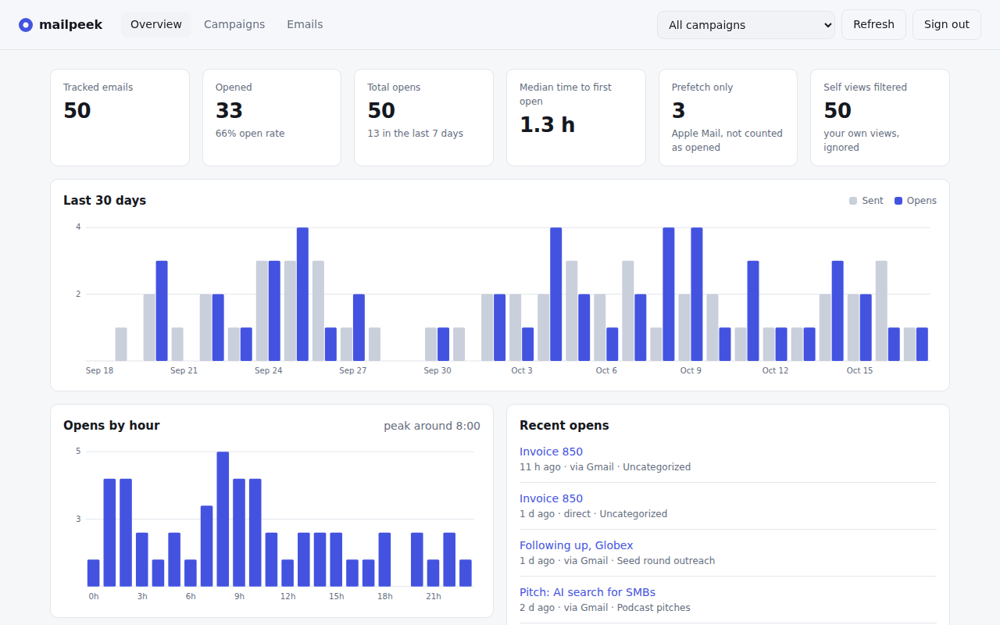
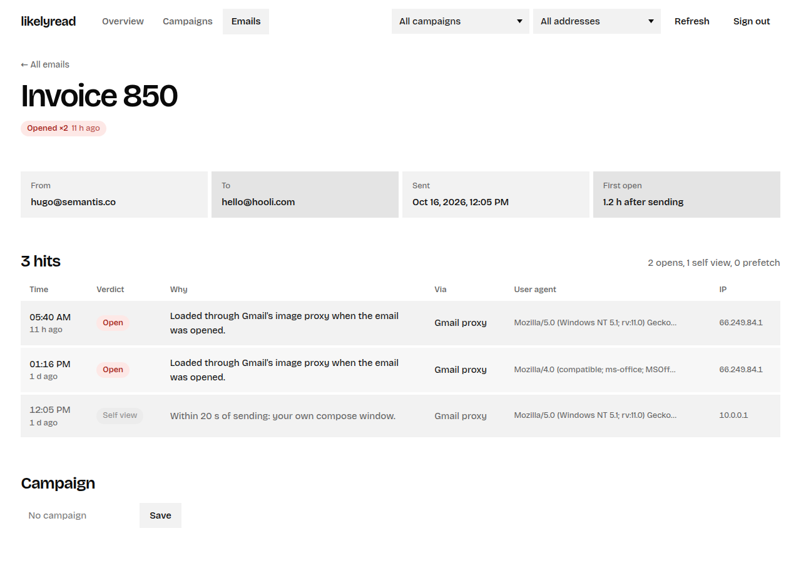
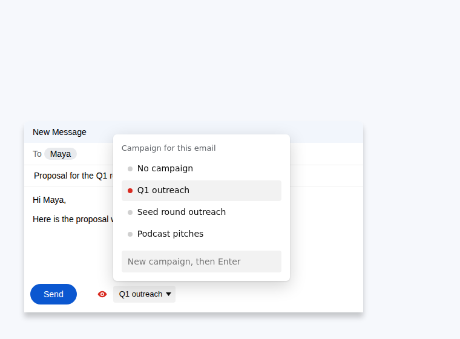

# likelyread

Self-hosted, open-source email open tracking for Gmail, for a single user. It tells you whether someone has **probably** opened an email you sent, with no third-party SaaS involved, and gives you a small dashboard to follow your campaigns.

- One small server (FastAPI + SQLite) behind Caddy, started with `docker compose up`.
- One Chrome extension that adds a tracking toggle to Gmail's compose window.
- One token. No accounts, no multi-tenancy, nothing leaves your VPS.



## How it works

1. When you click **Send** in Gmail with tracking on, the extension appends a 1x1 invisible image (`https://your-domain/p/<uuid>.gif`) to the email and registers the email with your server. Sending is never blocked or delayed.
2. When the recipient's mail client loads the image, the server logs a hit.
3. Hits are classified when you read them:
   - **self**: your own compose preview or your own view of the sent email (the extension tells the server, and also blocks the request in your browser);
   - **prefetch**: Apple Mail Privacy Protection loading images on delivery;
   - **open**: everything else.

See [SPEC.md](SPEC.md) for the full contract.

## Setup

You need a VPS (512 MB is plenty), Docker with the compose plugin, and a (sub)domain.

1. Point a DNS record such as `t.example.com` at the VPS.
2. Configure:
   ```sh
   git clone https://github.com/Hugo-SEQUIER/likelyread.git
   cd likelyread/deploy
   cp .env.example .env
   # set DOMAIN=t.example.com and LIKELYREAD_TOKEN=$(openssl rand -hex 32)
   ```
3. Start it:
   ```sh
   docker compose up -d
   curl https://t.example.com/healthz   # {"ok":true}
   ```
   Caddy gets a Let's Encrypt certificate automatically (ports 80 and 443 must be open).
4. Build and load the extension:
   ```sh
   cd ../extension
   npm install
   npm run build
   ```
   In Chrome, open `chrome://extensions`, turn on **Developer mode**, click **Load unpacked** and select `extension/dist`.
5. The options page opens. Enter `https://t.example.com` and your token, click **Save** (Chrome asks for permission to contact your server), then **Test connection**.
6. Open the dashboard at `https://t.example.com/` and sign in with the same token.

### Backups

Everything is in `deploy/data/likelyread.db`. A safe online copy from cron:

```sh
sqlite3 /path/to/deploy/data/likelyread.db ".backup '/backups/likelyread-$(date +%F).db'"
```

### Updating

```sh
git pull && cd deploy && docker compose up -d --build
```

## Campaigns and the dashboard

A campaign is just a label on an email.

- **While writing:** click the campaign name next to the red eye under Gmail's Send button and pick one, or type a new one. Your pick becomes the default for the next emails. The popup and options page set the same default.
- **After sending:** change an email's campaign from its detail page in the dashboard, or rename a whole campaign from the Campaigns tab.

The dashboard (`https://your-domain/`) has:

- **Overview:** tracked emails, open rate, total opens, opens in the last 7 days, median time to first open, a 30-day sent vs opens chart, opens by hour of day (useful to pick a send time), and the latest opens.
- **Campaigns:** open rate, opens and time to first open per campaign, side by side.
- **Emails:** search by subject, recipient or campaign, filter by status, and open any email to see every hit with its time, verdict, the reason for that verdict, user agent and IP.
- **From address:** each email records the address it was sent from (your account or a send-as alias). When you use more than one, the dashboard shows a From column and an address filter.

Open rate means *emails with at least one open / tracked emails*. Apple prefetches and your own views are never counted.





The dashboard is a static page with no data of its own: it reads the authenticated API with your token. Set `DASHBOARD=false` to turn it off.

## Email sent by scripts and AI agents

Anything that sends email itself (a script, a cron job, an AI agent) can use the `likelyread` CLI in `cli/`. It is a single Python file with no dependencies, and every command prints JSON.

```bash
ln -s "$PWD/cli/likelyread.py" ~/.local/bin/likelyread
export LIKELYREAD_URL=https://t.example.com   # what recipients load the pixel from
export LIKELYREAD_TOKEN=...                   # or ~/.config/likelyread/config.json (mode 600)
likelyread ping
```

Draft now, send later:

```bash
likelyread pixel                                   # {"id", "url", "img"}: keep the id with the draft
likelyread html --raw --id ID --file body.txt      # plain text to an HTML part, pixel appended
# ... send multipart/alternative: the text part unchanged, the HTML part above ...
likelyread track --id ID --subject "..." --to maya@example.com \
  --campaign "Q4 outreach" --from me@example.com --sent-at 1792251301849
```

`--sent-at` takes unix seconds, unix milliseconds (Gmail's `internalDate`) or ISO 8601, so registration can happen after the send, for example during reconciliation. Hits before the send time count as a draft preview, never as an open. Read results with `likelyread ls --campaign "Q4 outreach" --status opened`, `likelyread show ID`, `likelyread campaigns` and `likelyread stats`.

Send one email per recipient if you want to know who opened. Plain-text emails cannot carry a pixel: add an HTML part.

## Configuration

All settings live in `deploy/.env` (see `.env.example`):

| Variable | Default | Purpose |
|---|---|---|
| `DOMAIN` | | Domain Caddy serves and gets a certificate for. |
| `LIKELYREAD_TOKEN` | required | Bearer token for the API, the dashboard and the extension. The server refuses to start without it. |
| `ALLOWED_ORIGINS` | empty | Optional CORS origin for the extension (`chrome-extension://<id>`). Not needed for the extension to work. |
| `GRACE_SECONDS` | `20` | Hits this close to the send time count as your compose preview. |
| `SUPPRESS_WINDOW_SECONDS` | `60` | Hits within this window after you open your own sent email count as you. |
| `STORE_IP` | `true` | `false` stops storing IP addresses. |
| `RETENTION_DAYS` | `0` | Delete hits, and emails sent before the cutoff, older than this many days (`0` keeps everything). Hits for ids that were never registered are always dropped after 8 days. |
| `PIXEL_RATE_PER_MIN` | `60` | Pixel hits logged per IP per minute. |
| `DASHBOARD` | `true` | Serve the dashboard at `/`. |

## Known limitations

An "open" means *probably opened*, never proof.

| Limitation | Effect |
|---|---|
| Gmail image proxy | Opens by Gmail recipients show Google's IP and user agent, so there is no location. The proxy caches images, so **repeat opens may not register**. |
| Apple Mail Privacy Protection | Apple loads images on delivery, which looks like an open. Flagged as `prefetch` by its user agent (heuristic). |
| Images blocked by default | Some Outlook and corporate setups block images, so real opens are missed. |
| One pixel per email | With several recipients you can't tell who opened it. |
| Forwarding | Opens by people the email was forwarded to count as opens. |
| Gmail DOM changes | Can break injection. All Gmail selectors live in `extension/src/gmail-selectors.ts`, and failures are safe: the email is sent untracked. |
| Self-views | The extension blocks your own browser from loading your pixel directly, and when you open a message **you sent** in Gmail it tells the server, so the next 60 s count as self. Messages you received are never suppressed, so a recipient opening your email in this same browser still counts. |
| Deliverability | A fresh domain plus hidden images can raise spam scores. Use HTTPS and a domain with some history. |

## Privacy and legal

All data stays on your VPS. `STORE_IP=false` and `RETENTION_DAYS` let you keep less.

Tracking pixels fall under the EU ePrivacy rules and the GDPR. In France, the CNIL's [recommendation on tracking pixels in emails](https://www.cnil.fr/sites/default/files/2026-04/recommandation-pixels_de_suivi.pdf) (adopted 12 March 2026, published 14 April 2026) says that measuring opens to analyse or optimise campaigns requires the recipient's prior consent. That applies to B2B emails too. The exemptions are narrow: authentication security, and deliverability tracking for emails the recipient asked for. You are responsible for how you use this tool and for getting consent where it is required.

## Development

```sh
# server
cd server
python -m venv .venv && . .venv/bin/activate
pip install -r requirements-dev.txt
pytest -q
LIKELYREAD_TOKEN=devtoken0123456789 DB_PATH=./dev.db uvicorn app:create_app --factory --reload

# demo data for the dashboard (never on your real database)
python scripts/seed_demo.py ./demo.db

# extension
cd extension
npm install
npm test          # unit tests + compose tests against a fake Gmail DOM
npm run typecheck
npm run build     # outputs dist/
```

## Roadmap

- v0.2: status badges in Gmail's Sent list and thread view; per-email "stop tracking".
- v0.3: notifications (ntfy, Telegram, webhook) on first open, opt-in.
- v0.4: link click tracking.
- Later: per-recipient pixels, Firefox, a CLI.

## License

MIT
